# 🧠 Awesome AI Agent Memory 

  
  
  
  
  
  
  

  <strong>Curated ecosystem of SaaS platforms, frameworks, vector stores &amp; open-source memory architectures for autonomous AI agents.</strong>

  <em>Empowering LLMs, AI assistants, and multi-agent systems with persistent episodic memory, conversational context, semantic knowledge graphs, and long-term state management.</em>

  <a href="#-sector-overview--market-dynamics">Sector Overview</a> •
  <a href="#-saashosted-platforms">SaaS Platforms</a> •
  <a href="#-open-source-github-projects">Open-Source Projects</a> •
  <a href="#-memory-architectures--frameworks">Architecture Paradigms</a> •
  <a href="#-star-history">Star History</a> •
  <a href="#-support">Support</a> •
  <a href="#-how-to-contribute">Contribute</a>

---

## 📌 Introduction & Scope

Welcome to the **Awesome AI Agent Memory** repository! 🚀 This guide tracks category-defining **SaaS platforms**, **vector databases**, and **open-source memory layers** designed to solve the context window and persistence challenges of artificial intelligence.

Modern LLMs are inherently stateless. Agent memory systems provide the persistent substrate—spanning:
- 🧠 **Episodic Memory**: Recording chronological events, conversations, and past task executions.
- 📚 **Semantic Memory**: Storing structured facts, domain knowledge, and world models.
- ⚡ **Working Memory**: Managing active scratchpads, task graphs, and real-time reasoning context.
- 🎯 **Procedural Memory**: Retaining learned skills, habits, tools, and execution subroutines.

---

## 📑 Table of Contents

- [📊 Sector Overview & Market Dynamics](#-sector-overview--market-dynamics)
- [☁️ SaaS/Hosted Platforms](#-saashosted-platforms)
- [💻 Open-Source GitHub Projects](#-open-source-github-projects)
- [🧩 Memory Architectures & Frameworks](#-memory-architectures--frameworks)
- [📈 Star History](#-star-history)
- [💖 Support](#-support)
- [🤝 How to Contribute](#-how-to-contribute)
- [📜 Disclaimer](#-disclaimer)

---

## 📊 Sector Overview & Market Dynamics

The global AI agent and context memory infrastructure market is estimated at approximately **$6.4B to $11.5B** (as part of the rapidly growing $180B+ agentic AI trajectory by the mid-2030s, compounding at ~40% CAGR). The market exhibits a bifurcated structure: it is **moderately to highly fragmented** at the developer-tooling and specialized episodic memory layer where agile startups innovate, while remaining **concentrated** at the high-performance vector infrastructure and hyperscaler cloud layers where scale, compute efficiencies, and enterprise compliance create strong competitive moats.

---

## ☁️ SaaS/Hosted Platforms

| Platform | Valuation / Size | Starting Pricing | Free Tier Limits | Description |
| :--- | :--- | :--- | :--- | :--- |
| **[Redis Cloud](https://redis.io/cloud/)** | ~$2.0B (Valuation) | $5/month (Essentials plan; scalable RAM) | 30 MB shared DB, 100 ops/sec, 1 DB, free forever | Managed Redis service frequently used for session memory, caching, and low-latency vector search (Redis Search). |
| **[LangSmith](https://www.langchain.com/langsmith)** | ~$1.25B (LangChain valuation) | $39/seat/month (Plus plan; $2.50/1k extra traces) | 1 seat max, 5,000 base traces/month, 14-day retention, free forever | LangChain’s commercial platform for tracing, evaluation, and dataset management across agent runs. |
| **[Pinecone](https://www.pinecone.io/)** | ~$750M (Valuation) | $50/month min. usage (Serverless pay-as-you-go) | 2 GB storage (~300k vectors), 2M write units/mo, 1M read units/mo, 5 indexes, AWS us-east-1, free forever | Fully managed serverless vector database widely used as the embedding and retrieval backbone for agent memory. |
| **[Qdrant Cloud](https://qdrant.tech/)** | ~$350M–$500M (Est. valuation) | ~$80–$130/month (Standard cluster pricing based on vCPU/RAM) | 1 cluster, 0.5 vCPU, 1 GB RAM, 4 GB disk storage, free forever (no credit card required) | Managed offering of the open-source Qdrant vector database, optimized for high-performance similarity search. |
| **[Weaviate Cloud](https://weaviate.io/)** | ~$200M (Valuation) | $45/month minimum (Flex consumption tier) | 1 sandbox cluster, 100,000 objects, 1 GB RAM, 10 GB disk, 2k embeddings/day, free forever | Managed vector database service with native hybrid search, used for semantic memory and retrieval in agent systems. |
| **[Mem0](https://mem0.ai/)** | ~$150M (Est. valuation) | $19/month (Starter tier: 50k adds, 5k retrievals) | 10,000 add requests/month, 1,000 retrieval requests/month, 1 project, free forever | Memory layer for personalized AI assistants and agents, offering hosted APIs for long-term user/agent memory. |
| **[Zilliz Cloud](https://zilliz.com/)** | ~$113M+ (Venture capital raised) | $99/month (Standard dedicated tier; or serverless pay-as-you-go) | 5 GB storage (~1M vectors), 2.5M vCUs/month, 5 collections, free forever (or 30-day $100 credit trial for dedicated) | Managed Milvus vector database service for large-scale embedding storage and retrieval powering agent memory. |
| **[Chroma Cloud](https://www.trychroma.com/)** | ~$75M (Valuation) | ~$2.50/GiB written + $0.33/GiB-mo storage (Pay-as-you-go) | Up to 1M stored embeddings and introductory developer credits, free forever tier | Hosted variant of Chroma embedding database designed for developer-friendly agent memory backends. |
| **[Langfuse](https://langfuse.com/)** | Acquired by ClickHouse ($15B valuation; ~$4M seed prior) | $29/month (Core tier; $8 per 100k extra units) | 50,000 events/units per month, unlimited users, free forever | Open-source LLM engineering and observability platform for tracing, evaluation, and analytics of agent memory usage. |
| **[Zep](https://www.getzep.com/)** | Seed stage / YC (Undisclosed private valuation) | $125/month (Flex plan: 50,000 credits included) | 10,000 credits/month for prototyping, free forever | Long-term memory platform for LLM applications and agents, providing conversation memory and temporal knowledge graphs. |

---

## 💻 Open-Source GitHub Projects

Sorted descending by GitHub stargazer count:

- **[Mem0](https://github.com/mem0ai/mem0)**   
  The universal memory layer for personalized AI agents and assistants. Provides intuitive APIs to extract, update, search, and recall user/agent memory across multi-turn interactions.

- **[LlamaIndex](https://github.com/run-llama/llama_index)**   
  Comprehensive data framework for LLM applications, featuring modular chat stores, index structures, and memory modules for context-augmented agents.

- **[Milvus](https://github.com/milvus-io/milvus)**   
  Cloud-native open-source vector database built for massive similarity search and high-throughput embedding retrieval in enterprise agent deployments.

- **[LangGraph](https://github.com/langchain-ai/langgraph)**   
  Stateful agent orchestration framework with native checkpointing, cyclical execution graphs, and time-travel memory management for durable multi-agent workflows.

- **[Phidata](https://github.com/phidatahq/phidata)**   
  High-performance framework for building multi-modal AI agents with built-in memory, persistent session storage, knowledge bases, and tool calling.

- **[FAISS](https://github.com/facebookresearch/faiss)**   
  Meta's gold-standard library for efficient similarity search and clustering of dense vectors, serving as the foundational indexing engine for agent memory architectures.

- **[Langfuse](https://github.com/langfuse/langfuse)**   
  Open-source LLM engineering platform providing deep observability, memory session tracing, prompt management, and evaluation for complex agent pipelines.

- **[Qdrant](https://github.com/qdrant/qdrant)**   
  High-performance vector search engine written in Rust, featuring rich payload filtering, dynamic index segmentation, and high-concurrency retrieval for agent context.

- **[Chroma](https://github.com/chroma-core/chroma)**   
  The AI-native open-source embedding database designed for developer simplicity, local prototyping, and modular agent memory storage.

- **[Letta](https://github.com/letta-ai/letta)**   
  Autonomous agent framework (formerly MemGPT) where agents actively manage their own multi-tiered memory hierarchy, context paging, and persistent state.

- **[pgvector](https://github.com/pgvector/pgvector)**   
  Open-source vector similarity search extension for PostgreSQL, enabling developers to store relational agent data, conversation logs, and vector embeddings in a single database.

- **[Weaviate](https://github.com/weaviate/weaviate)**   
  Open-source vector database featuring out-of-the-box hybrid search, multi-modal vectorization, and modular integration with major LLM and agent frameworks.

- **[Zep](https://github.com/getzep/zep)**   
  Fast, scalable memory service for LLM applications and conversational agents, specializing in temporal knowledge graph extraction, summarization, and semantic search.

- **[Infinity](https://github.com/infiniflow/infinity)**   
  Next-generation AI-native database built for rich multi-modal vector search, sparse-dense hybrid retrieval, and real-time agent memory infrastructure.

---

## 🧩 Memory Architectures & Frameworks

When architecting production agent memory, developers typically employ a layered approach:

1. **Session & Scratchpad Memory**: Fast in-memory state or KV-stores (Redis, SQLite) handling short-term conversation context and task graphs.
2. **Episodic & Fact Extraction Layer**: Specialized engines like **Mem0** or **Zep** that automatically digest conversation transcripts into permanent entity relationships and temporal graphs.
3. **Semantic Long-Term Store**: Vector databases (**Qdrant**, **Milvus**, **Chroma**, **Weaviate**, **pgvector**) maintaining dense vector embeddings for fuzzy retrieval and RAG.
4. **Self-Managed Context Paging**: Autonomous agent frameworks like **Letta** where the LLM explicitly edits its own memory bank via tool calling.

---

## 📈 Star History

---

## 💖 Support

If you find this repository valuable:
- ⭐ **Star this repository** to help others discover it!
- 🍴 **Fork the repo** to contribute your favorite memory frameworks.
- 📢 **Share with fellow AI engineers and agent builders.**
- ☕ **Buy a coffee / Sponsor**: If you'd like to support the ongoing maintenance and curation of open AI resources, please visit the [GitHub Sponsor Dashboard](https://github.com/sponsors/ishandutta2007). Your support is greatly appreciated! ❤️

---

## 🤝 How to Contribute

Contributions are warmly welcomed! To suggest a new tool or update an existing entry:
1. 🍴 Fork this repository.
2. 📝 Add your tool in either the SaaS table or Open-Source section (keep star sorting and format intact).
3. 🔗 Include accurate links, descriptive summaries, and verifiable pricing/metrics.
4. 🚀 Submit a Pull Request with a clear explanation of why the addition benefits the AI agent memory ecosystem.

---

## 📜 Disclaimer

- This list is community-curated for informational and educational purposes. Inclusion does not imply official endorsement.
- Agent memory architectures store persistent interaction data. Ensure appropriate privacy compliance (GDPR, CCPA), encryption at rest/transit, and access control when deploying in production.

---

  Maintained with ❤️ by <a href="https://github.com/ishandutta2007">Ishan Dutta</a> and the open-source AI community.

